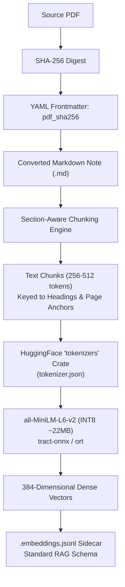

# AGENTS.md — Agent Engineering Guide & Phased Implementation Plan

This document serves as the canonical operating manual and technical roadmap for AI coding agents working on `pdfmd-lite`. It outlines architectural constraints, codebase conventions, verification standards, and the phased implementation roadmap derived from [`IMPROVEMENTS.md`](./IMPROVEMENTS.md) and settled Architectural Decision Records ([`docs/adr/`](./docs/adr/)).

---

## 1. Project Mission & Foundational Constraints

`pdfmd-lite` is an autonomous, high-performance, pure-Rust offline document conversion engine transforming scientific and technical PDFs into Obsidian-flavored Markdown with native LaTeX mathematics and structured tables.

### Non-Negotiable Architectural Rules

1. **100% Pure Offline & Zero External LLM** ([ADR 0001](./docs/adr/0001-pure-offline-zero-llm-architecture.md)):
   - Never introduce dependencies on external cloud APIs (Gemini, OpenAI, Anthropic), local LLM runtimes (Ollama, vLLM, llama.cpp), or network clients (`reqwest`, `ureq`) during standard document conversion.
   - All models execute locally in-process via `tract-onnx` (pure-Rust SIMD) with optional `ort` (ONNX Runtime) feature acceleration.

2. **Strict Environment Variable Prohibition**:
   - **Never use system environment variables** for application settings, paths, directory locations, or runtime flags.
   - Rely strictly on typed CLI arguments (`src/cli.rs`) and configuration files (`pdfmd-lite.toml` via `src/config.rs`).
   - Exception: API keys only if a future external tool integration explicitly mandates it (currently zero API keys required).

3. **Domain Vocabulary Integrity** ([`GLOSSARY.md`](./GLOSSARY.md)):
   - Enforce canonical domain terms (*Raw Crop*, *Three-Way Layout Router*, *Geometric Table Grid Extraction*, *Embedding Sidecar*, *Section-Aware Semantic Chunking*, *Document Content-Hash Idempotency*).
   - Avoid banned synonyms documented in `GLOSSARY.md`.

4. **Architectural Decision Records** ([`docs/adr/`](./docs/adr/)):
   - When introducing hard-to-reverse architectural changes, record a numbered ADR adhering to the 3-gate rule (*Hard to reverse*, *Surprising without context*, *Real trade-off*).

---

## 2. Codebase Topology & Core Subsystems

```
pdfmd-lite/
├── Cargo.toml                  # Workspace dependencies, features, and [[bench]] targets
├── GLOSSARY.md                 # Ubiquitous language definitions & banned synonyms
├── IMPROVEMENTS.md             # Living implementation changelog & benchmark baselines
├── FUTURE_IMPROVEMENTS.md      # Live multi-core profiling analysis & telemetry snapshots
├── docs/adr/                   # Architectural Decision Records (0001 - 0010)
├── benches/
│   └── ocr_bench.rs            # Criterion benchmarks for serial/batched OCR & pipeline
└── src/
    ├── main.rs                 # CLI entry point
    ├── lib.rs                  # Library crate roots & public exports
    ├── cli.rs                  # Argument parsing, note formatter, vault image migration
    ├── config.rs               # TOML configuration loader (pdfmd-lite.toml)
    ├── concurrency.rs          # Hardware-aware memory & core concurrency governor (ADR 0003)
    ├── batch.rs                # Multi-document batch runner, resume, slugging (ADR 0004, 0007)
    ├── pipeline.rs             # Streaming rasterization & multi-phase page processing pipeline
    ├── markdown.rs             # Note synthesis, frontmatter, heading promotion, LaTeX fixing
    ├── xycut.rs                # Recursive XY-Cut++ 2D reading-order partitioning
    ├── pdf.rs                  # lopdf DOM parsing, stream extraction, text extraction
    ├── backends/
    │   └── indra/              # In-process SVTR OCR engine, vocabularies, constrained CTC
    ├── figure/
    │   ├── mod.rs              # ImageFormat, ImageOptions, RGB flattening, crop saving
    │   ├── caption.rs          # Proximity and pattern-based figure caption matching
    │   ├── latex.rs            # RapidLaTeXOCR transformer, typo repair, balance validation
    │   ├── table.rs            # Geometric Table Grid Extraction & Markdown synthesis
    │   ├── slanet.rs           # SLANet neural table structure extractor (ort)
    │   ├── yolo.rs             # YOLOv8n DocLayNet layout detector (tract-onnx)
    │   └── pdf_stream.rs       # Direct PDF vector/raster image stream extractor
    └── metadata/
        ├── mod.rs              # Document metadata structures
        └── gliner.rs           # DOM-first GLiNER NER & pattern fallback (ADR 0006)
```

---

## 3. Phased Implementation Roadmap

### Phase 0 & Phase 1 — Completed & Verified ✅
- **Phase 0**: Statistical Criterion benchmarking harness in `benches/ocr_bench.rs`.
- **P1.1**: Batched SVTR OCR inference plans (batch sizes 4 and 8 across 7 bucket widths) in `src/backends/indra/recognize.rs`.
- **P1.2**: Formula box fast-path for tiny single-character crops in `src/pipeline.rs`.
- **P1.3**: Conservative concurrency memory governor ($350\text{ MB}$ base, $200\text{ MB}$/worker) in `src/concurrency.rs`.
- **P1.4**: Prevention of nested thread oversubscription in `src/batch.rs`.
- **P1.5**: Direct byte-slice RGBA $\rightarrow$ RGB flattening in `src/figure/mod.rs`.
- **Incremental Batch Resume**: Skip already converted notes (>100 bytes) via `-r` / `--resume`.
- **Note Formatter & Delimiter Sanitizer**: `--format-notes`, `--fix-latex`, `--convert-images-to-jpeg`.

---

### Phase 2 — In-Process Sentence Embeddings & Semantic Obsidian RAG ✅

> **Architectural Decisions**: [ADR 0009](./docs/adr/0009-per-note-embedding-sidecars-and-frontmatter-hash.md) & [ADR 0010](./docs/adr/0010-inprocess-minilm-sentence-embeddings.md)  
> **Status**: Completed & Verified ✅  
> **Primary Goal**: Deliver lightweight, 100% offline semantic retrieval and vector sidecars for Obsidian RAG plugins without cloud APIs or centralized vector databases.



#### Milestone 2.1: Model Engine & Tokenizer Integration
- **Objective**: Implement the in-process sentence embedding evaluator.
- **Tasks**:
  1. Update `Cargo.toml`: Add `tokenizers = { version = "0.20", default-features = false, features = ["onig"] }` behind the `embed-models` feature flag.
  2. Create `src/embeddings/mod.rs` and `src/embeddings/engine.rs`:
     - Load `models/embeddings/model.onnx` (`all-MiniLM-L6-v2` INT8) via `tract-onnx`.
     - Implement tokenization with `tokenizers::Tokenizer` from `models/embeddings/tokenizer.json`.
     - Execute mean pooling over token embeddings with attention mask normalization to produce unit-normalized 384-dimensional `Vec<f32>`.
  3. Support dual-backend execution: allow `ort` acceleration if feature `ort` is active.
- **Verification**: Unit test evaluating a known sentence against reference cosine similarities.

#### Milestone 2.2: Section-Aware Semantic Chunking
- **Objective**: Implement structural document partitioning that respects technical context.
- **Tasks**:
  1. Create `src/embeddings/chunking.rs`.
  2. Parse output Markdown into semantic chunks bounded to **256–512 tokens** (~1,200 characters):
     - Split on top-level and sub-level Markdown headings (`#`, `##`, `###`).
     - Track physical page boundaries via `<!-- Page N -->` anchors.
     - Never split across table grids (`| ... |`) or display math blocks (`$$...$$`).
     - Apply 10% sliding overlap only across unbroken, continuous prose paragraphs.
  3. Populate chunk metadata: `chunk_id`, `page_num`, `heading`, `text`.
- **Verification**: Chunking tests on multi-page technical documents with equations and tables.

#### Milestone 2.3: Sidecar Serialization & Pipeline Integration
- **Objective**: Wire embedding generation into document conversion and write JSONL sidecars.
- **Tasks**:
  1. Define `EmbeddingRecord` matching the standard RAG schema:
     ```rust
     #[derive(Serialize, Deserialize)]
     pub struct EmbeddingRecord {
         pub chunk_id: String,
         pub page_num: usize,
         pub heading: Option<String>,
         pub text: String,
         pub embedding: Vec<f32>,
     }
     ```
  2. Add `--embed` / `--embeddings` CLI flag in `src/cli.rs`.
  3. When enabled, stream or batch-write `<slug>/<slug>.embeddings.jsonl` immediately after note synthesis in `src/pipeline.rs`.
- **Verification**: End-to-end conversion generating valid JSON Lines files with 384-dimensional float arrays.

#### Milestone 2.4: Retroactive Vault Indexer
- **Objective**: Allow embedding existing Obsidian vaults without re-converting PDFs.
- **Tasks**:
  1. Add `pdfmd-lite --embed <vault-or-dir>` mode in `src/cli.rs`.
  2. Recursively discover existing `.md` files, parse headings and page comments, generate semantic chunks, and write/update adjacent `<slug>.embeddings.jsonl` files.
  3. Skip notes whose `.embeddings.jsonl` exists and is newer than the Markdown file.
- **Verification**: CLI integration test scanning sample Markdown directories.

#### Milestone 2.5: Model Provisioning Command
- **Objective**: Provide automated downloading for gitignored quantized models.
- **Tasks**:
  1. Implement `pdfmd-lite --download-models` in `src/cli.rs`.
  2. Download official INT8 `all-MiniLM-L6-v2` ONNX model and `tokenizer.json` directly into `models/embeddings/`.
  3. Validate SHA-256 checksums of downloaded model assets.
- **Verification**: Command downloads and verifies model files on clean environments.

---

### Phase 3 — Workflow, Operational Hardening & UX 🛠️

> **Status**: In Progress  
> **Primary Goal**: Enhance operational reliability, developer ergonomics, and vault synchronization.

#### Milestone 3.1: Cryptographic Content-Hash Idempotency ([ADR 0009](./docs/adr/0009-per-note-embedding-sidecars-and-frontmatter-hash.md)) ✅
- Compute SHA-256 hash of source PDF during batch traversal.
- Store `pdf_sha256: "<hash>"` in note YAML frontmatter.
- Batch resume checks `pdf_sha256` in existing `.md` before reading or rasterizing pages, achieving 100% deterministic, stateless idempotency.

#### Milestone 3.2: Opt-In Single-File Base64 Mode ([ADR 0009](./docs/adr/0009-per-note-embedding-sidecars-and-frontmatter-hash.md)) ✅
- Added `--embed-images-base64` / `--base64-images` CLI flag and `AppConfig.embed_images_base64`.
- When enabled, encodes image crops into `data:image/jpeg;base64,...` data URIs directly within Markdown image links, skipping the creation of `<slug>_images/` asset directories.
- Preserves standard Markdown links and shields base64 data URIs from wiki-link rewriting during note formatting passes.
- Kept `<slug>/<slug>_images/` disk directory layout as the default per [ADR 0004](./docs/adr/0004-short-slug-batch-directory-layout.md).

#### Milestone 3.3: Rich Batch Progress & ETA Indicators ✅
- Integrated `indicatif` progress bar in `src/progress.rs` for multi-document batch runs:
  - Total documents completed / remaining.
  - Active document names and concurrent page workers displayed dynamically.
  - Estimated time of arrival (ETA) derived from rolling average per-page latency.
  - Non-flickering message logging (`pb.println`) ensuring clean output above active bars.
- Suppressed cleanly when `-q` / `--quiet` is specified.

#### Milestone 3.4: Directory Watch Mode & Conversion Dry-Run ✅
- Implemented autonomous directory watch mode in `src/watch.rs` (`--watch <input-dir> <output-dir>`):
  - Uses `notify` with native OS filesystem events and debouncing (800ms) to detect completed PDF writes.
  - Automatically converts new or modified PDFs while preserving relative folder hierarchy in the output vault.
  - Performs initial batch pass with stateless content-hash (`pdf_sha256`) resume to catch up on un-indexed documents.
- Implemented comprehensive conversion dry-run mode (`--dry-run`):
  - Previews complete conversion plans, page counts, memory budgets ($350\text{ MB} + W \times 200\text{ MB}$), and estimated conversion times.
  - Checks existing note content hashes to identify `WOULD_SKIP`, `WOULD_OVERWRITE`, and `WOULD_CONVERT` statuses.
  - Operates strictly read-only without rasterizing pages or modifying files on disk.

#### Milestone 3.5: CI Quality Gates & Code Health
- Establish GitHub Actions CI pipeline:
  - `cargo fmt --check`
  - `cargo clippy --all-targets -- -D warnings`
  - `cargo test --all-targets`
  - `cargo check --benches`
  - `cargo deny check` for license and advisory audits.

---

## 4. Verification & Testing Standards for Agents

Before completing any implementation step, agents **must** execute and pass the following quality gates:

```powershell
# 1. Compilation and syntax verification
cargo check --all-targets

# 2. Benchmarks compilation check
cargo check --benches

# 3. Comprehensive unit and integration test suite
cargo test

# 4. Strict clippy linting
cargo clippy --all-targets -- -D warnings
```

### Git Commit & PR Protocol
- Use Conventional Commits (`feat:`, `fix:`, `perf:`, `docs:`, `test:`, `chore:`).
- Document performance delta or benchmark impact in commit bodies.
- Never commit large binaries, model weights (`models/`), or `.zip` archives.
- Ensure all new architectural trade-offs are accompanied by an ADR under `docs/adr/`.
