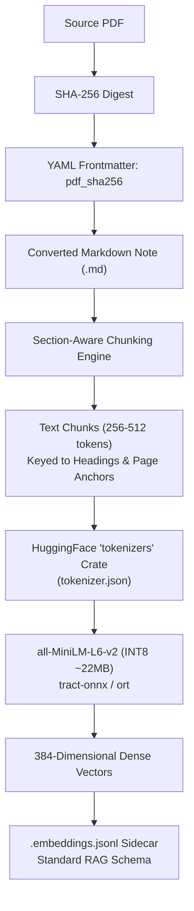
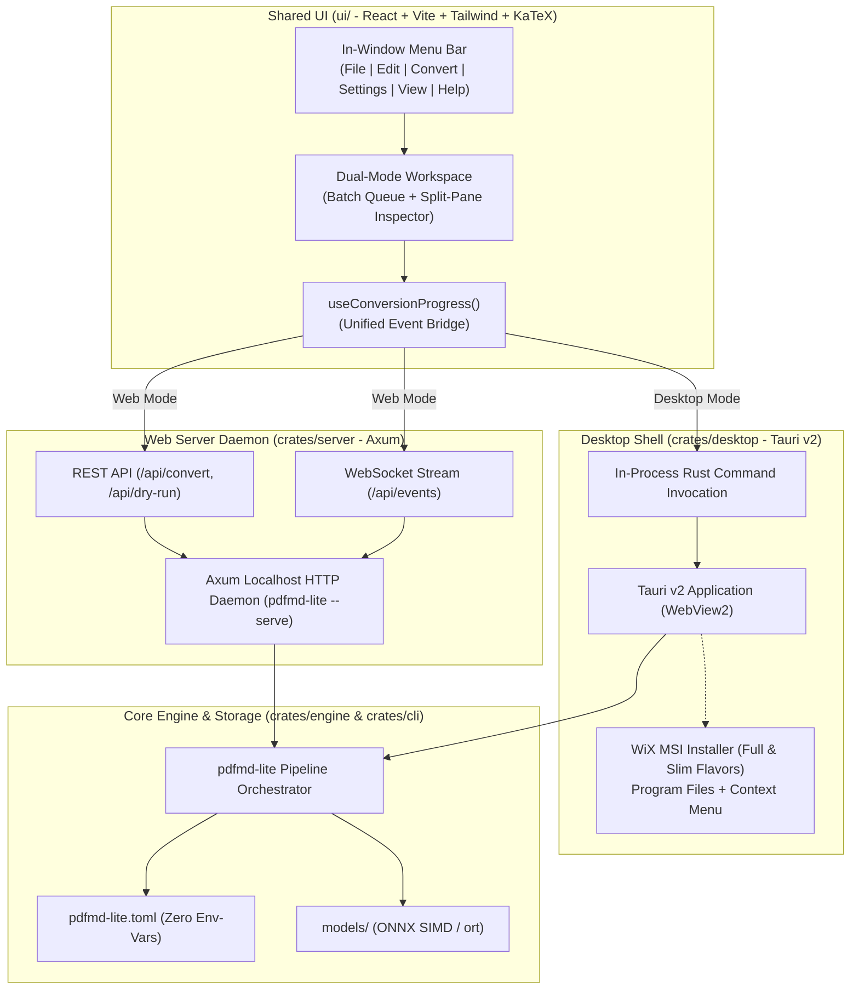

# AGENTS.md — Agent Engineering Guide & Phased Implementation Plan

This document serves as the canonical operating manual and technical roadmap for AI coding agents working on `pdfmd-lite`. It outlines architectural constraints, codebase conventions, verification standards, and the phased implementation roadmap derived from [`IMPROVEMENTS.md`](./IMPROVEMENTS.md) and settled Architectural Decision Records ([`docs/adr/`](./docs/adr/)).

---

## 1. Project Mission & Foundational Constraints

`pdfmd-lite` is an autonomous, high-performance, pure-Rust offline document conversion engine transforming scientific and technical PDFs into Obsidian-flavored Markdown with native LaTeX mathematics and structured tables.

### Non-Negotiable Architectural Rules

1. **100% Pure Offline & Zero External LLM** ([ADR 0001](./docs/adr/0001-pure-offline-zero-llm-architecture.md)):
   - Never introduce dependencies on external cloud APIs (Gemini, OpenAI, Anthropic), local LLM runtimes (Ollama, vLLM, llama.cpp), or network clients (`reqwest`, `ureq`) during standard document conversion.
   - All models execute locally in-process via `tract-onnx` (pure-Rust SIMD) with optional `ort` (ONNX Runtime) feature acceleration.

2. **Strict Environment Variable Prohibition**:
   - **Never use system environment variables** for application settings, paths, directory locations, or runtime flags.
   - Rely strictly on typed CLI arguments (`src/cli.rs`) and configuration files (`pdfmd-lite.toml` via `src/config.rs`).
   - Exception: API keys only if a future external tool integration explicitly mandates it (currently zero API keys required).

3. **Domain Vocabulary Integrity** ([`GLOSSARY.md`](./GLOSSARY.md)):
   - Enforce canonical domain terms (*Raw Crop*, *Three-Way Layout Router*, *Geometric Table Grid Extraction*, *Embedding Sidecar*, *Section-Aware Semantic Chunking*, *Document Content-Hash Idempotency*).
   - Avoid banned synonyms documented in `GLOSSARY.md`.

4. **Architectural Decision Records** ([`docs/adr/`](./docs/adr/)):
   - When introducing hard-to-reverse architectural changes, record a numbered ADR adhering to the 3-gate rule (*Hard to reverse*, *Surprising without context*, *Real trade-off*).

---

## 2. Codebase Topology & Core Subsystems

```
pdfmd-lite/
├── Cargo.toml                  # Workspace dependencies, features, and [[bench]] targets
├── GLOSSARY.md                 # Ubiquitous language definitions & banned synonyms
├── IMPROVEMENTS.md             # Living implementation changelog & benchmark baselines
├── FUTURE_IMPROVEMENTS.md      # Live multi-core profiling analysis & telemetry snapshots
├── docs/adr/                   # Architectural Decision Records (0001 - 0010)
├── benches/
│   └── ocr_bench.rs            # Criterion benchmarks for serial/batched OCR & pipeline
└── src/
    ├── main.rs                 # CLI entry point
    ├── lib.rs                  # Library crate roots & public exports
    ├── cli.rs                  # Argument parsing, note formatter, vault image migration
    ├── config.rs               # TOML configuration loader (pdfmd-lite.toml)
    ├── concurrency.rs          # Hardware-aware memory & core concurrency governor (ADR 0003)
    ├── batch.rs                # Multi-document batch runner, resume, slugging (ADR 0004, 0007)
    ├── pipeline.rs             # Streaming rasterization & multi-phase page processing pipeline
    ├── markdown.rs             # Note synthesis, frontmatter, heading promotion, LaTeX fixing
    ├── xycut.rs                # Recursive XY-Cut++ 2D reading-order partitioning
    ├── pdf.rs                  # lopdf DOM parsing, stream extraction, text extraction
    ├── backends/
    │   └── indra/              # In-process SVTR OCR engine, vocabularies, constrained CTC
    ├── figure/
    │   ├── mod.rs              # ImageFormat, ImageOptions, RGB flattening, crop saving
    │   ├── caption.rs          # Proximity and pattern-based figure caption matching
    │   ├── latex.rs            # RapidLaTeXOCR transformer, typo repair, balance validation
    │   ├── table.rs            # Geometric Table Grid Extraction & Markdown synthesis
    │   ├── slanet.rs           # SLANet neural table structure extractor (ort)
    │   ├── yolo.rs             # YOLOv8n DocLayNet layout detector (tract-onnx)
    │   └── pdf_stream.rs       # Direct PDF vector/raster image stream extractor
    └── metadata/
        ├── mod.rs              # Document metadata structures
        └── gliner.rs           # DOM-first GLiNER NER & pattern fallback (ADR 0006)
```

---

## 3. Phased Implementation Roadmap

### Phase 0 & Phase 1 — Completed & Verified ✅
- **Phase 0**: Statistical Criterion benchmarking harness in `benches/ocr_bench.rs`.
- **P1.1**: Batched SVTR OCR inference plans (batch sizes 4 and 8 across 7 bucket widths) in `src/backends/indra/recognize.rs`.
- **P1.2**: Formula box fast-path for tiny single-character crops in `src/pipeline.rs`.
- **P1.3**: Conservative concurrency memory governor ($350\text{ MB}$ base, $200\text{ MB}$/worker) in `src/concurrency.rs`.
- **P1.4**: Prevention of nested thread oversubscription in `src/batch.rs`.
- **P1.5**: Direct byte-slice RGBA $\rightarrow$ RGB flattening in `src/figure/mod.rs`.
- **Incremental Batch Resume**: Skip already converted notes (>100 bytes) via `-r` / `--resume`.
- **Note Formatter & Delimiter Sanitizer**: `--format-notes`, `--fix-latex`, `--convert-images-to-jpeg`.

---

### Phase 2 — In-Process Sentence Embeddings & Semantic Obsidian RAG ✅

> **Architectural Decisions**: [ADR 0009](./docs/adr/0009-per-note-embedding-sidecars-and-frontmatter-hash.md) & [ADR 0010](./docs/adr/0010-inprocess-minilm-sentence-embeddings.md)  
> **Status**: Completed & Verified ✅  
> **Primary Goal**: Deliver lightweight, 100% offline semantic retrieval and vector sidecars for Obsidian RAG plugins without cloud APIs or centralized vector databases.



#### Milestone 2.1: Model Engine & Tokenizer Integration
- **Objective**: Implement the in-process sentence embedding evaluator.
- **Tasks**:
  1. Update `Cargo.toml`: Add `tokenizers = { version = "0.20", default-features = false, features = ["onig"] }` behind the `embed-models` feature flag.
  2. Create `src/embeddings/mod.rs` and `src/embeddings/engine.rs`:
     - Load `models/embeddings/model.onnx` (`all-MiniLM-L6-v2` INT8) via `tract-onnx`.
     - Implement tokenization with `tokenizers::Tokenizer` from `models/embeddings/tokenizer.json`.
     - Execute mean pooling over token embeddings with attention mask normalization to produce unit-normalized 384-dimensional `Vec<f32>`.
  3. Support dual-backend execution: allow `ort` acceleration if feature `ort` is active.
- **Verification**: Unit test evaluating a known sentence against reference cosine similarities.

#### Milestone 2.2: Section-Aware Semantic Chunking
- **Objective**: Implement structural document partitioning that respects technical context.
- **Tasks**:
  1. Create `src/embeddings/chunking.rs`.
  2. Parse output Markdown into semantic chunks bounded to **256–512 tokens** (~1,200 characters):
     - Split on top-level and sub-level Markdown headings (`#`, `##`, `###`).
     - Track physical page boundaries via `<!-- Page N -->` anchors.
     - Never split across table grids (`| ... |`) or display math blocks (`$$...$$`).
     - Apply 10% sliding overlap only across unbroken, continuous prose paragraphs.
  3. Populate chunk metadata: `chunk_id`, `page_num`, `heading`, `text`.
- **Verification**: Chunking tests on multi-page technical documents with equations and tables.

#### Milestone 2.3: Sidecar Serialization & Pipeline Integration
- **Objective**: Wire embedding generation into document conversion and write JSONL sidecars.
- **Tasks**:
  1. Define `EmbeddingRecord` matching the standard RAG schema:
     ```rust
     #[derive(Serialize, Deserialize)]
     pub struct EmbeddingRecord {
         pub chunk_id: String,
         pub page_num: usize,
         pub heading: Option<String>,
         pub text: String,
         pub embedding: Vec<f32>,
     }
     ```
  2. Add `--embed` / `--embeddings` CLI flag in `src/cli.rs`.
  3. When enabled, stream or batch-write `<slug>/<slug>.embeddings.jsonl` immediately after note synthesis in `src/pipeline.rs`.
- **Verification**: End-to-end conversion generating valid JSON Lines files with 384-dimensional float arrays.

#### Milestone 2.4: Retroactive Vault Indexer
- **Objective**: Allow embedding existing Obsidian vaults without re-converting PDFs.
- **Tasks**:
  1. Add `pdfmd-lite --embed <vault-or-dir>` mode in `src/cli.rs`.
  2. Recursively discover existing `.md` files, parse headings and page comments, generate semantic chunks, and write/update adjacent `<slug>.embeddings.jsonl` files.
  3. Skip notes whose `.embeddings.jsonl` exists and is newer than the Markdown file.
- **Verification**: CLI integration test scanning sample Markdown directories.

#### Milestone 2.5: Model Provisioning Command
- **Objective**: Provide automated downloading for gitignored quantized models.
- **Tasks**:
  1. Implement `pdfmd-lite --download-models` in `src/cli.rs`.
  2. Download official INT8 `all-MiniLM-L6-v2` ONNX model and `tokenizer.json` directly into `models/embeddings/`.
  3. Validate SHA-256 checksums of downloaded model assets.
- **Verification**: Command downloads and verifies model files on clean environments.

---

### Phase 3 — Workflow, Operational Hardening & UX 🛠️

> **Status**: Completed & Verified ✅  
> **Primary Goal**: Enhance operational reliability, developer ergonomics, and vault synchronization.

#### Milestone 3.1: Cryptographic Content-Hash Idempotency ([ADR 0009](./docs/adr/0009-per-note-embedding-sidecars-and-frontmatter-hash.md)) ✅
- Compute SHA-256 hash of source PDF during batch traversal.
- Store `pdf_sha256: "<hash>"` in note YAML frontmatter.
- Batch resume checks `pdf_sha256` in existing `.md` before reading or rasterizing pages, achieving 100% deterministic, stateless idempotency.

#### Milestone 3.2: Opt-In Single-File Base64 Mode ([ADR 0009](./docs/adr/0009-per-note-embedding-sidecars-and-frontmatter-hash.md)) ✅
- Added `--embed-images-base64` / `--base64-images` CLI flag and `AppConfig.embed_images_base64`.
- When enabled, encodes image crops into `data:image/jpeg;base64,...` data URIs directly within Markdown image links, skipping the creation of `<slug>_images/` asset directories.
- Preserves standard Markdown links and shields base64 data URIs from wiki-link rewriting during note formatting passes.
- Kept `<slug>/<slug>_images/` disk directory layout as the default per [ADR 0004](./docs/adr/0004-short-slug-batch-directory-layout.md).

#### Milestone 3.3: Rich Batch Progress & ETA Indicators ✅
- Integrated `indicatif` progress bar in `src/progress.rs` for multi-document batch runs:
  - Total documents completed / remaining.
  - Active document names and concurrent page workers displayed dynamically.
  - Estimated time of arrival (ETA) derived from rolling average per-page latency.
  - Non-flickering message logging (`pb.println`) ensuring clean output above active bars.
- Suppressed cleanly when `-q` / `--quiet` is specified.

#### Milestone 3.4: Directory Watch Mode & Conversion Dry-Run ✅
- Implemented autonomous directory watch mode in `src/watch.rs` (`--watch <input-dir> <output-dir>`):
  - Uses `notify` with native OS filesystem events and debouncing (800ms) to detect completed PDF writes.
  - Automatically converts new or modified PDFs while preserving relative folder hierarchy in the output vault.
  - Performs initial batch pass with stateless content-hash (`pdf_sha256`) resume to catch up on un-indexed documents.
- Implemented comprehensive conversion dry-run mode (`--dry-run`):
  - Previews complete conversion plans, page counts, memory budgets ($350\text{ MB} + W \times 200\text{ MB}$), and estimated conversion times.
  - Checks existing note content hashes to identify `WOULD_SKIP`, `WOULD_OVERWRITE`, and `WOULD_CONVERT` statuses.
  - Operates strictly read-only without rasterizing pages or modifying files on disk.

#### Milestone 3.5: CI Quality Gates & Code Health ✅
- Established comprehensive GitHub Actions CI pipeline:
  - `cargo fmt --check` (code formatting across crate and benches)
  - `cargo clippy --all-targets -- -D warnings` (strict zero-warning gate)
  - `cargo test --all-targets` (comprehensive unit and integration test suite)
  - `cargo check --benches` (benchmark compilation validation)
  - `cargo-deny-action` with `deny.toml` for license, advisory, and bans auditing.
- Automated code formatting pass applied across the entire codebase.

---

### Phase 4 — Advanced Engine Optimization, Observability & Hybrid Extraction 🚀

> **Architectural Decisions**: [ADR 0011](./docs/adr/0011-fine-grained-session-mutexes-and-inplace-grayscale-masking.md) & [ADR 0012](./docs/adr/0012-baseline-aware-hybrid-dom-extraction.md)  
> **Status**: Completed & Verified ✅  
> **Primary Goal**: Deliver maximum multi-core CPU throughput, zero memory duplication churn, production observability, and 5×–10× faster digital text extraction without compromising mathematical fidelity.

#### Milestone 4.1: In-Place Grayscale Canvas Masking ([ADR 0011](./docs/adr/0011-fine-grained-session-mutexes-and-inplace-grayscale-masking.md)) ✅
- **Objective**: Eliminate intermediate 30 MB RGBA deep clones per page.
- **Tasks**:
  1. Implemented `pub fn mask_gray_regions_mut(gray: &mut GrayImage, regions: &[FigureRect])` in `src/figure/mod.rs` with unit tests for bounds padding and clamping.
  2. Implemented `detect_gray` in `src/backends/indra/detect.rs` and `transcribe_gray_with_script` in `src/backends/indra/engine.rs` to process grayscale canvases directly.
  3. In `src/pipeline.rs`, convert `page_img.to_luma8()` directly once and apply in-place visual masking, eliminating ~50 MB of transient buffer clones per page.
- **Verification**: Verified via `test_mask_gray_regions_mut` and the entire 89-test suite.

#### Milestone 4.2: Fine-Grained RapidLaTeXOCR Session Mutexing ([ADR 0011](./docs/adr/0011-fine-grained-session-mutexes-and-inplace-grayscale-masking.md)) ✅
- **Objective**: Eliminate cross-worker thread freezes during autoregressive equation decoding.
- **Tasks**:
  1. Refactored `RapidLatexEngine::predict` in `src/figure/latex.rs`.
  2. Narrowed the `decoder` session lock scope strictly to the single `run(...)` step (~1–2ms), extracting `step_logits` and releasing the lock immediately before token projection, greedy argmax, and repetition gating.
  3. Preserved the resident session memory footprint strictly within the 350 MB base concurrency budget without duplicating session weights.
- **Verification**: Verified via test suite and criterion benchmark execution with zero compiler warnings.

#### Milestone 4.3: Structured Observability & Tracing Telemetry ✅
- **Objective**: Integrate industrial-grade structured logging with non-flickering progress bars and file export.
- **Tasks**:
  1. Added `tracing` and `tracing-subscriber` (with `fmt`, `std`, `ansi`, `registry` features) to `Cargo.toml`.
  2. Implemented `src/telemetry.rs` with `init_telemetry` and `parse_log_level`:
     - CLI flags `--log-file <PATH>` and `--log-level <trace|debug|info|warn|error>` (default: `info`).
     - Added `log_file` and `log_level` to `AppConfig` in `src/config.rs`.
     - Supports quiet mode (`-q` / `--quiet`) by silencing the console layer while keeping disk log-file writes intact.
  3. Replaced scattered `eprintln!` warnings across `src/pipeline.rs`, `src/batch.rs`, and `src/watch.rs` with structured `tracing::warn!` and `tracing::error!` events.
- **Verification**: Verified via `test_parse_log_level`, `test_init_telemetry_with_log_file`, and the entire 91-test suite.

#### Milestone 4.4: Baseline-Aware Hybrid DOM Extraction ([ADR 0012](./docs/adr/0012-baseline-aware-hybrid-dom-extraction.md)) ✅
- **Objective**: Accelerate digital PDF text processing by 5×–10× while preserving subscripts, superscripts, and equations.
- **Tasks**:
  1. Added `--dom-extraction <auto|always|never>` (and `--dom-mode`) CLI parameters and `dom_extraction` config option in `pdfmd-lite.toml`.
  2. Implemented baseline vertical offset tracking ($\Delta y$) in `src/pdf.rs` (`extract_baseline_aware_dom_text_lines`) to detect and synthesize Markdown sub/superscripts (`_e`, `^2`).
  3. Implemented font CMap `/ToUnicode` catalog validation in `can_use_hybrid_dom`; falls back to pure-vision Indra OCR automatically if CMaps are missing or corrupt.
  4. Excluded YOLOv8n formula (Class 2) and visual picture regions from DOM text streams, routing formulas to RapidLaTeXOCR with reading-order anchor insertion.
- **Verification**: Verified via `test_dom_extraction_mode_parsing`, `test_baseline_aware_subscript_superscript_detection`, `test_dom_exclusion_of_layout_regions`, and the entire 94-test suite.

---

### Phase 5 — Unified Desktop (Tauri v2 + MSI) & Web Application (Axum Daemon) 🖥️🌐

> **Architectural Decisions**: [ADR 0013](./docs/adr/0013-tauri-axum-unified-desktop-web-architecture.md)  
> **Status**: Planned / Specified 📋  
> **Primary Goal**: Deliver a lightweight, high-performance native Windows desktop application with MSI installer and an embedded local web application, exposing 100% of CLI features through an intuitive multi-menu interface, split-pane inspector, and real-time streaming telemetry without cloud dependencies or Electron bloat.



#### Milestone 5.1: Workspace Monorepo Restructuring & Headless Engine API
- **Objective**: Decouple core pipeline logic into a dedicated library crate within a Cargo workspace.
- **Tasks**:
  1. Restructure repository into Cargo workspace:
     - `crates/engine` (lib crate containing `pdfmd-lite` pipeline, backends, layout, OCR, embeddings).
     - `crates/cli` (binary crate with CLI argument parser `pdfmd-lite`).
     - `crates/server` (embedded Axum web server daemon).
     - `crates/desktop` (Tauri v2 desktop application shell).
  2. Implement `ProgressEmitter` trait in `crates/engine` allowing decoupled event emission (progress bars, logs, page events).
  3. Wire CLI to consume the headless `crates/engine` crate without functional regressions.
- **Verification**: `cargo check --all-targets` and `cargo test --all-targets` pass across the workspace.

#### Milestone 5.2: Shared Single-Page Application (SPA) Frontend
- **Objective**: Build the responsive React + Vite + Tailwind CSS interface in `ui/` with full menu bar hierarchy.
- **Tasks**:
  1. Initialize `ui/` with Vite, React 18/19, TypeScript, Tailwind CSS, Lucide Icons, and KaTeX.
  2. Implement in-window menu bar with keyboard shortcuts:
     - **File**: Open PDF(s), Open Directory (Batch), Watch Directory, Open Vault, Export Markdown, Exit.
     - **Edit**: Format Notes (`--format-notes`), Fix LaTeX Delimiters (`--fix-latex`), Convert PNG to JPEG (`--convert-images-to-jpeg`), Clear Completed.
     - **Convert**: Start Conversion, Dry-Run Preview (`--dry-run`), Resume Batch (`-r`), Stop/Cancel, Generate Embeddings (`--embed`), Retroactively Embed Vault.
     - **Settings**: Language/Script (`-l`), DOM Extraction Mode (`--dom-extraction`), Figure/Image format & quality, Table crops, Inline Base64, Concurrency limit (`-j`), Logging (`--log-level`, `--log-file`).
     - **View**: Toggle Split-Pane Inspector, Batch Queue Dashboard, Live Log Console, Theme Selector (Dark/Light/Obsidian).
     - **Help**: Model Provisioning Manager (`--download-models`), About `pdfmd-lite`.
  3. Implement Dual-Mode Views:
     - **Batch Queue Dashboard**: Interactive job queue, drag-and-drop zone, ETA counter, memory budget projection.
     - **Split-Pane Inspector**: Side-by-side view showing source rendered PDF page canvas adjacent to generated Markdown with live KaTeX math and table grids.
  4. Create `useConversionProgress` hook abstracting Tauri IPC vs WebSocket telemetry.
- **Verification**: Frontend builds cleanly to `ui/dist` via `npm run build`.

#### Milestone 5.3: Embedded Axum Web Server Daemon (`pdfmd-lite --serve`)
- **Objective**: Deliver in-process local web server daemon for browser execution.
- **Tasks**:
  1. Implement `crates/server` using `axum`, `tokio`, and `tower-http`:
     - Embed or serve static assets from `ui/dist` via `ServeDir`.
     - `POST /api/convert`: Initiates single or batch conversion.
     - `POST /api/dry-run`: Returns execution plan, page counts, and memory budgets.
     - `GET /api/events`: WebSocket stream broadcasting real-time progress, worker states, and `tracing` logs.
     - `GET /api/config` and `PUT /api/config`: Reads and updates `pdfmd-lite.toml`.
     - `POST /api/upload`: Handles multipart drag-and-drop file upload for browser-based ad-hoc conversion.
  2. Add `pdfmd-lite --serve [PORT]` CLI command in `crates/cli` (default: `127.0.0.1:3000`).
- **Verification**: End-to-end browser conversion run on `localhost:3000` via Chrome/Edge.

#### Milestone 5.4: Tauri v2 Desktop Shell & Native IPC Commands
- **Objective**: Package the desktop application with native WebView2 integration and direct Rust IPC.
- **Tasks**:
  1. Configure `crates/desktop` with Tauri v2 (`src-tauri` / `tauri.conf.json`).
  2. Implement Tauri commands bridging frontend calls directly to `crates/engine`:
     - `convert_pdf`, `dry_run`, `watch_directory`, `format_notes`, `fix_latex`.
     - File/Folder dialog integration (`tauri-plugin-dialog`) for native Windows folder and file pickers.
  3. Stream progress events directly to the desktop window via `app_handle.emit("conversion-progress", payload)`.
  4. Sync settings directly to `pdfmd-lite.toml` in the application data directory.
- **Verification**: `cargo tauri dev` launches the desktop window, opens native file dialogs, and executes conversions.

#### Milestone 5.5: Windows MSI Packaging & Dual-Flavor Distribution
- **Objective**: Generate official Windows `.msi` installers via WiX Toolset.
- **Tasks**:
  1. Configure WiX installer in `tauri.conf.json` under `bundle.windows.wix`:
     - Install location: `C:\Program Files\pdfmd-lite`.
     - Add Start Menu shortcut and Desktop icon.
     - Register Windows Explorer right-click context menu (*"Convert with pdfmd-lite"*).
  2. Implement Dual-Flavor packaging scripts in `scripts/package-msi.ps1`:
     - **Full Offline MSI** (~180MB): Pre-packages `models/indra/`, `models/layout/`, and `models/embeddings/`.
     - **Slim MSI** (~15MB): Installs binaries and triggers on-demand model download via the in-app provisioning dialog.
- **Verification**: MSI installs cleanly on a Windows test environment, creates shortcuts, and runs offline conversions.

---

---

## 4. Verification & Testing Standards for Agents

Before completing any implementation step, agents **must** execute and pass the following quality gates:

```powershell
# 1. Compilation and syntax verification
cargo check --all-targets

# 2. Benchmarks compilation check
cargo check --benches

# 3. Comprehensive unit and integration test suite
cargo test

# 4. Strict clippy linting
cargo clippy --all-targets -- -D warnings
```

### Git Commit & PR Protocol
- Use Conventional Commits (`feat:`, `fix:`, `perf:`, `docs:`, `test:`, `chore:`).
- Document performance delta or benchmark impact in commit bodies.
- Never commit large binaries, model weights (`models/`), or `.zip` archives.
- Ensure all new architectural trade-offs are accompanied by an ADR under `docs/adr/`.
