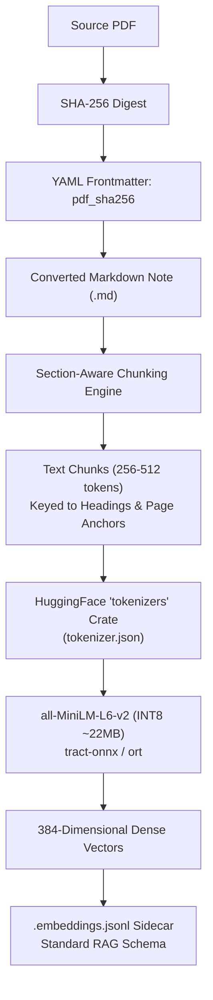
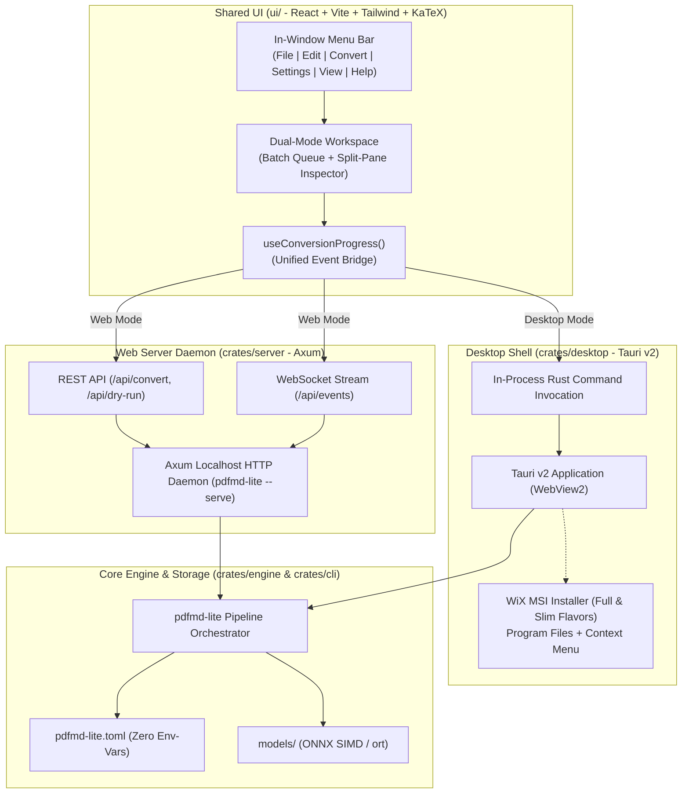

# Implemented Phases — Historical Implementation Record

This document records the completed implementation phases and technical milestones achieved in `pdfmd-lite`.

---

## Summary of Completed Phases

| Phase | Title | Primary Outcomes |
|---|---|---|
| **Phase 0 & 1** | Benchmarking & Pipeline Core | Statistical Criterion benchmarking, batched SVTR OCR, memory governor, single-character formula fast-path, and incremental batch resume. |
| **Phase 2** | Sentence Embeddings & Semantic Obsidian RAG | In-process `all-MiniLM-L6-v2` dense embeddings, section-aware chunking (256–512 tokens), JSONL sidecar generation, and vault retro-indexing. |
| **Phase 3** | Workflow, Operational Hardening & UX | Cryptographic SHA-256 idempotency, opt-in Base64 images, dynamic progress indicators, directory watch mode, dry-run mode, and CI quality gates. |
| **Phase 4** | Engine Optimization & Hybrid Extraction | In-place grayscale masking, fine-grained equation decoder mutexing, structured `tracing` telemetry, and baseline-aware hybrid DOM text extraction. |
| **Phase 5** | Unified Desktop & Web Application | Workspace monorepo decoupling, React 19 + Tailwind SPA, Axum localhost daemon (`--serve`), Tauri v2 desktop shell, and WiX v5 MSI packaging. |
| **Phase 6** | Reliability, Zero-Copy Model Locator & Hardening | Process-wide panic hook with thread-local suppression, zero-copy cascading `ModelLocator`, strict config gating, unified error boundaries, and `--doctor` diagnostics. |
| **Phase 7** | Hardware Acceleration, Split-Pane Inspector & Hybrid Table Serialization | DirectML execution provider, generic `SessionPool<T>`, live split-pane canvas streaming, and hybrid table serialization with cell span reconstruction. |
| **Phase 8** | CMap Font Decoder, Hybrid Routing & Release 0.7.2 | Adobe CMap `/ToUnicode` stream parsing, encoding fallbacks, hybrid DOM routing & in-place masking gating, and WiX v5 MSI installers. |

---

## Detailed Milestone History

### Phase 0 & Phase 1 — Benchmarking & Pipeline Core ✅

- **Phase 0**: Statistical Criterion benchmarking harness in `benches/ocr_bench.rs`.
- **P1.1**: Batched SVTR OCR inference plans (batch sizes 4 and 8 across 7 bucket widths) in `src/backends/indra/recognize.rs`.
- **P1.2**: Formula box fast-path for tiny single-character crops in `src/pipeline.rs`.
- **P1.3**: Conservative concurrency memory governor ($350\text{ MB}$ base, $200\text{ MB}$/worker) in `src/concurrency.rs`.
- **P1.4**: Prevention of nested thread oversubscription in `src/batch.rs`.
- **P1.5**: Direct byte-slice RGBA $\rightarrow$ RGB flattening in `src/figure/mod.rs`.
- **Incremental Batch Resume**: Skip already converted notes (>100 bytes) via `-r` / `--resume`.
- **Note Formatter & Delimiter Sanitizer**: `--format-notes`, `--fix-latex`, `--convert-images-to-jpeg`.

---

### Phase 2 — In-Process Sentence Embeddings & Semantic Obsidian RAG ✅

> **Primary Goal**: Deliver lightweight, 100% offline semantic retrieval and vector sidecars for Obsidian RAG plugins without cloud APIs or centralized vector databases.



#### Milestone 2.1: Model Engine & Tokenizer Integration
- **Objective**: Implement the in-process sentence embedding evaluator.
- **Tasks**:
  1. Updated `Cargo.toml`: Added `tokenizers = { version = "0.20", default-features = false, features = ["onig"] }` behind the `embed-models` feature flag.
  2. Created `src/embeddings/mod.rs` and `src/embeddings/engine.rs`:
     - Load `models/embeddings/model.onnx` (`all-MiniLM-L6-v2` INT8) via `tract-onnx`.
     - Implement tokenization with `tokenizers::Tokenizer` from `models/embeddings/tokenizer.json`.
     - Execute mean pooling over token embeddings with attention mask normalization to produce unit-normalized 384-dimensional `Vec<f32>`.
  3. Supported dual-backend execution: allow `ort` acceleration if feature `ort` is active.
- **Verification**: Unit test evaluating a known sentence against reference cosine similarities.

#### Milestone 2.2: Section-Aware Semantic Chunking
- **Objective**: Implement structural document partitioning that respects technical context.
- **Tasks**:
  1. Created `src/embeddings/chunking.rs`.
  2. Parse output Markdown into semantic chunks bounded to **256–512 tokens** (~1,200 characters):
     - Split on top-level and sub-level Markdown headings (`#`, `##`, `###`).
     - Track physical page boundaries via `<!-- Page N -->` anchors.
     - Never split across table grids (`| ... |`) or display math blocks (`$$...$$`).
     - Apply 10% sliding overlap only across unbroken, continuous prose paragraphs.
  3. Populate chunk metadata: `chunk_id`, `page_num`, `heading`, `text`.
- **Verification**: Chunking tests on multi-page technical documents with equations and tables.

#### Milestone 2.3: Sidecar Serialization & Pipeline Integration
- **Objective**: Wire embedding generation into document conversion and write JSONL sidecars.
- **Tasks**:
  1. Defined `EmbeddingRecord` matching the standard RAG schema:
     ```rust
     #[derive(Serialize, Deserialize)]
     pub struct EmbeddingRecord {
         pub chunk_id: String,
         pub page_num: usize,
         pub heading: Option<String>,
         pub text: String,
         pub embedding: Vec<f32>,
     }
     ```
  2. Added `--embed` / `--embeddings` CLI flag in `src/cli.rs`.
  3. When enabled, stream or batch-write `<slug>/<slug>.embeddings.jsonl` immediately after note synthesis in `src/pipeline.rs`.
- **Verification**: End-to-end conversion generating valid JSON Lines files with 384-dimensional float arrays.

#### Milestone 2.4: Retroactive Vault Indexer
- **Objective**: Allow embedding existing Obsidian vaults without re-converting PDFs.
- **Tasks**:
  1. Added `pdfmd-lite --embed <vault-or-dir>` mode in `src/cli.rs`.
  2. Recursively discover existing `.md` files, parse headings and page comments, generate semantic chunks, and write/update adjacent `<slug>.embeddings.jsonl` files.
  3. Skip notes whose `.embeddings.jsonl` exists and is newer than the Markdown file.
- **Verification**: CLI integration test scanning sample Markdown directories.

#### Milestone 2.5: Model Provisioning Command
- **Objective**: Provide automated downloading for gitignored quantized models.
- **Tasks**:
  1. Implemented `pdfmd-lite --download-models` in `src/cli.rs`.
  2. Download official INT8 `all-MiniLM-L6-v2` ONNX model and `tokenizer.json` directly into `models/embeddings/`.
  3. Validate SHA-256 checksums of downloaded model assets.
- **Verification**: Command downloads and verifies model files on clean environments.

---

### Phase 3 — Workflow, Operational Hardening & UX 🛠️

> **Primary Goal**: Enhance operational reliability, developer ergonomics, and vault synchronization.

#### Milestone 3.1: Cryptographic Content-Hash Idempotency
- Computed SHA-256 hash of source PDF during batch traversal.
- Stored `pdf_sha256: "<hash>"` in note YAML frontmatter.
- Batch resume checks `pdf_sha256` in existing `.md` before reading or rasterizing pages, achieving 100% deterministic, stateless idempotency.

#### Milestone 3.2: Opt-In Single-File Base64 Mode
- Added `--embed-images-base64` / `--base64-images` CLI flag and `AppConfig.embed_images_base64`.
- When enabled, encodes image crops into `data:image/jpeg;base64,...` data URIs directly within Markdown image links, skipping the creation of `<slug>_images/` asset directories.
- Preserves standard Markdown links and shields base64 data URIs from wiki-link rewriting during note formatting passes.
- Kept `<slug>/<slug>_images/` disk directory layout as default.

#### Milestone 3.3: Rich Batch Progress & ETA Indicators
- Integrated `indicatif` progress bar in `src/progress.rs` for multi-document batch runs:
  - Total documents completed / remaining.
  - Active document names and concurrent page workers displayed dynamically.
  - Estimated time of arrival (ETA) derived from rolling average per-page latency.
  - Non-flickering message logging (`pb.println`) ensuring clean output above active bars.
- Suppressed cleanly when `-q` / `--quiet` is specified.

#### Milestone 3.4: Directory Watch Mode & Conversion Dry-Run
- Implemented autonomous directory watch mode in `src/watch.rs` (`--watch <input-dir> <output-dir>`):
  - Uses `notify` with native OS filesystem events and debouncing (800ms) to detect completed PDF writes.
  - Automatically converts new or modified PDFs while preserving relative folder hierarchy in the output vault.
  - Performs initial batch pass with stateless content-hash (`pdf_sha256`) resume to catch up on un-indexed documents.
- Implemented comprehensive conversion dry-run mode (`--dry-run`):
  - Previews complete conversion plans, page counts, memory budgets ($350\text{ MB} + W \times 200\text{ MB}$), and estimated conversion times.
  - Checks existing note content hashes to identify `WOULD_SKIP`, `WOULD_OVERWRITE`, and `WOULD_CONVERT` statuses.
  - Operates strictly read-only without rasterizing pages or modifying files on disk.

#### Milestone 3.5: CI Quality Gates & Code Health
- Established comprehensive GitHub Actions CI pipeline:
  - `cargo fmt --check` (code formatting across crate and benches)
  - `cargo clippy --all-targets -- -D warnings` (strict zero-warning gate)
  - `cargo test --all-targets` (comprehensive unit and integration test suite)
  - `cargo check --benches` (benchmark compilation validation)
  - `cargo-deny-action` with `deny.toml` for license, advisory, and bans auditing.
- Automated code formatting pass applied across the entire codebase.

---

### Phase 4 — Advanced Engine Optimization, Observability & Hybrid Extraction 🚀

> **Primary Goal**: Deliver maximum multi-core CPU throughput, zero memory duplication churn, production observability, and 5×–10× faster digital text extraction without compromising mathematical fidelity.

#### Milestone 4.1: In-Place Grayscale Canvas Masking
- **Objective**: Eliminate intermediate 30 MB RGBA deep clones per page.
- **Tasks**:
  1. Implemented `pub fn mask_gray_regions_mut(gray: &mut GrayImage, regions: &[FigureRect])` in `src/figure/mod.rs` with unit tests for bounds padding and clamping.
  2. Implemented `detect_gray` in `src/backends/indra/detect.rs` and `transcribe_gray_with_script` in `src/backends/indra/engine.rs` to process grayscale canvases directly.
  3. In `src/pipeline.rs`, convert `page_img.to_luma8()` directly once and apply in-place visual masking, eliminating ~50 MB of transient buffer clones per page.
- **Verification**: Verified via `test_mask_gray_regions_mut` and the entire test suite.

#### Milestone 4.2: Fine-Grained RapidLaTeXOCR Session Mutexing
- **Objective**: Eliminate cross-worker thread freezes during autoregressive equation decoding.
- **Tasks**:
  1. Refactored `RapidLatexEngine::predict` in `src/figure/latex.rs`.
  2. Narrowed the `decoder` session lock scope strictly to the single `run(...)` step (~1–2ms), extracting `step_logits` and releasing the lock immediately before token projection, greedy argmax, and repetition gating.
  3. Preserved the resident session memory footprint strictly within the 350 MB base concurrency budget without duplicating session weights.
- **Verification**: Verified via test suite and criterion benchmark execution with zero compiler warnings.

#### Milestone 4.3: Structured Observability & Tracing Telemetry
- **Objective**: Integrate industrial-grade structured logging with non-flickering progress bars and file export.
- **Tasks**:
  1. Added `tracing` and `tracing-subscriber` (with `fmt`, `std`, `ansi`, `registry` features) to `Cargo.toml`.
  2. Implemented `src/telemetry.rs` with `init_telemetry` and `parse_log_level`:
     - CLI flags `--log-file <PATH>` and `--log-level <trace|debug|info|warn|error>` (default: `info`).
     - Added `log_file` and `log_level` to `AppConfig` in `src/config.rs`.
     - Supports quiet mode (`-q` / `--quiet`) by silencing the console layer while keeping disk log-file writes intact.
  3. Replaced scattered `eprintln!` warnings across `src/pipeline.rs`, `src/batch.rs`, and `src/watch.rs` with structured `tracing::warn!` and `tracing::error!` events.
- **Verification**: Verified via `test_parse_log_level`, `test_init_telemetry_with_log_file`, and the test suite.

#### Milestone 4.4: Baseline-Aware Hybrid DOM Extraction
- **Objective**: Accelerate digital PDF text processing by 5×–10× while preserving subscripts, superscripts, and equations.
- **Tasks**:
  1. Added `--dom-extraction <auto|always|never>` (and `--dom-mode`) CLI parameters and `dom_extraction` config option in `pdfmd-lite.toml`.
  2. Implemented baseline vertical offset tracking ($\Delta y$) in `src/pdf.rs` (`extract_baseline_aware_dom_text_lines`) to detect and synthesize Markdown sub/superscripts (`_e`, `^2`).
  3. Implemented font CMap `/ToUnicode` catalog validation in `can_use_hybrid_dom`; falls back to pure-vision Indra OCR automatically if CMaps are missing or corrupt.
  4. Excluded YOLOv8n formula (Class 2) and visual picture regions from DOM text streams, routing formulas to RapidLaTeXOCR with reading-order anchor insertion.
- **Verification**: Verified via `test_dom_extraction_mode_parsing`, `test_baseline_aware_subscript_superscript_detection`, `test_dom_exclusion_of_layout_regions`, and the test suite.

---

### Phase 5 — Unified Desktop (Tauri v2 + MSI) & Web Application (Axum Daemon) 🖥️🌐

> **Primary Goal**: Deliver a lightweight, high-performance native Windows desktop application with MSI installer and an embedded local web application, exposing 100% of CLI features through an intuitive multi-menu interface, split-pane inspector, and real-time streaming telemetry without cloud dependencies or Electron bloat.



#### Milestone 5.1: Workspace Monorepo Restructuring & Headless Engine API
- **Objective**: Decouple core pipeline logic into a dedicated library crate within a Cargo workspace.
- **Tasks**:
  1. Restructured repository into Cargo workspace (`crates/engine`, `crates/cli`, `crates/server`, `crates/desktop`).
  2. Implemented `ProgressEmitter` trait in `crates/engine` allowing decoupled event emission.
  3. Wired CLI and tests to consume headless `crates/engine`.
- **Verification**: Verified via `cargo check --all-targets` and `cargo test --workspace` (94/94 passed).

#### Milestone 5.2: Shared Single-Page Application (SPA) Frontend
- **Objective**: Build the responsive React + Vite + Tailwind CSS interface in `ui/` with full menu bar hierarchy.
- **Tasks**:
  1. Initialized `ui/` with Vite, React 19, TypeScript, Tailwind CSS, Lucide Icons, and KaTeX.
  2. Implemented in-window menu bar with keyboard shortcuts:
     - **File**: Open PDF(s), Open Directory (Batch), Watch Directory, Open Vault, Export Markdown, Exit.
     - **Edit**: Format Notes (`--format-notes`), Fix LaTeX Delimiters (`--fix-latex`), Convert PNG to JPEG (`--convert-images-to-jpeg`), Clear Completed.
     - **Convert**: Start Conversion, Dry-Run Preview (`--dry-run`), Resume Batch (`-r`), Stop/Cancel, Generate Embeddings (`--embed`), Retroactively Embed Vault.
     - **Settings**: Language/Script (`-l`), DOM Extraction Mode (`--dom-extraction`), Figure/Image format & quality, Table crops, Inline Base64, Concurrency limit (`-j`), Logging (`--log-level`, `--log-file`).
     - **View**: Toggle Split-Pane Inspector, Batch Queue Dashboard, Live Log Console, Theme Selector (Dark/Light/Obsidian).
     - **Help**: Model Provisioning Manager (`--download-models`), Keyboard Shortcuts, About `pdfmd-lite`.
  3. Implemented Dual-Mode Views:
     - **Batch Queue Dashboard**: Interactive job queue, drag-and-drop zone, ETA counter, memory budget projection.
     - **Split-Pane Inspector**: Side-by-side view showing source rendered PDF page canvas adjacent to generated Markdown with live KaTeX math and table grids.
  4. Created `useConversionProgress` hook abstracting Tauri IPC vs WebSocket telemetry.
- **Verification**: Frontend builds cleanly to `ui/dist` via `npm run build`.

#### Milestone 5.3: Embedded Axum Web Server Daemon (`pdfmd-lite --serve`)
- **Objective**: Deliver in-process local web server daemon for browser execution.
- **Tasks**:
  1. Implemented `crates/server` using `axum`, `tokio`, and `tower-http`:
     - Embeds and serves static assets from `ui/dist` via `ServeDir` and `ServeFile`.
     - `POST /api/convert`: Initiates single or batch conversion.
     - `POST /api/dry-run`: Returns execution plan, page counts, and memory budgets.
     - `GET /api/events`: WebSocket stream broadcasting real-time progress, worker states, and `tracing` logs.
     - `GET /api/config` and `PUT /api/config`: Reads and updates `pdfmd-lite.toml`.
     - `POST /api/upload`: Handles multipart drag-and-drop file upload for browser-based ad-hoc conversion.
     - Note maintenance & embedding endpoints: `/api/format-notes`, `/api/convert-png-to-jpeg`, `/api/embed-vault`, `/api/download-models`.
  2. Added `pdfmd-lite --serve [PORT]` CLI command in `crates/cli` (default: `127.0.0.1:3000`).
- **Verification**: Verified via `cargo clippy --all-targets -- -D warnings` and test suite.

#### Milestone 5.4: Tauri v2 Desktop Shell & Native IPC Commands
- **Objective**: Package the desktop application with native WebView2 integration and direct Rust IPC.
- **Tasks**:
  1. Configured `crates/desktop` with Tauri v2 (`tauri.conf.json`, `build.rs`, `Cargo.toml`).
  2. Implemented Tauri commands bridging frontend calls directly to `crates/engine`:
     - `get_config`, `save_config`, `dry_run`, `start_conversion`, `format_notes`, `convert_png_to_jpeg`, `embed_vault`, `download_models`.
  3. Streamed progress events directly to the desktop window via `app_handle.emit("conversion-progress", payload)`.
  4. Synced settings directly to `pdfmd-lite.toml`.
- **Verification**: Verified via `cargo check -p pdfmd-lite-desktop` and zero-warning `cargo clippy`.

#### Milestone 5.5: Windows MSI Packaging & Dual-Flavor Distribution
- **Objective**: Generate official Windows `.msi` installers via WiX Toolset v5.
- **Tasks**:
  1. Configured WiX XML source manifests in `wix/main.wxs` and `wix/full.wxs`:
     - Install location: `C:\Program Files\pdfmd-lite`.
     - Start Menu shortcut and Desktop icon.
     - Registered Windows Explorer right-click context menu (*"Convert to Markdown with pdfmd-lite"*).
  2. Implemented Dual-Flavor packaging script in `scripts/package-msi.ps1`:
     - **Slim MSI** (`pdfmd-lite-v0.1.0-x64-slim.msi`, ~77 MB): Installs CLI + Desktop executables with on-demand model download.
     - **Full Offline MSI** (`pdfmd-lite-v0.1.0-x64-full-offline.msi`, ~225 MB): Pre-packages all quantized offline models (`models/`) for air-gapped deployment.
     - Generates SHA-256 checksum sidecars.
- **Verification**: Verified via `scripts/package-msi.ps1` building both MSI packages and checksums cleanly.

---

### Phase 6 — Reliability, Zero-Copy Model Locator & Hardening ✅

> **Primary Goal**: Close critical P0 reliability gaps, eliminate ambient directory and CARGO_MANIFEST_DIR dependencies, eliminate heap allocations for embedded static models, unify error boundaries across workers, and provide comprehensive `--doctor` offline diagnostics.

#### Milestone 6.1: Thread-Safe Panic Hook & Font Error Isolation
- **Tasks**:
  1. Replaced unsafe global `take_hook` / `set_hook` swapping in `crates/engine/src/pdf.rs` with a single startup hook routing through an RAII thread-local `Cell<bool>` suppression guard (`safe_extract_text_by_pages`).
  2. Guaranteed that font parsing panics inside `pdf-extract` remain suppressed without silencing panics on concurrent worker threads in multi-document batch runs.

#### Milestone 6.2: Cascading Model Locator & Zero-Copy Provisioning (ADR 0014)
- **Tasks**:
  1. Built `ModelLocator` in `crates/engine/src/model_locator.rs` implementing deterministic descending precedence:
     - Explicit `--models-dir` CLI flag or `AppConfig.models_dir`.
     - Binary-adjacent directory (`std::env::current_exe().parent()/models`).
     - Workspace / developer directories (`./models`, `../../models`).
     - Embedded static binary slices via `Cow::Borrowed(&'static [u8])`.
  2. Eliminated `EMBEDDED_*.to_vec()` heap allocations across `indra/models.rs` and `figure/models.rs`.
  3. Replaced ambient `CARGO_MANIFEST_DIR` runtime lookups in `lib.rs`, `slanet.rs`, `latex.rs`, and `gliner.rs` with `ModelLocator` discovery.
  4. Added `--doctor` diagnostic inspection command in `crates/cli` reporting model status, existence, size in MB, and SHA-256 hash.

#### Milestone 6.3: Strict Configuration Validation & Wiring
- **Tasks**:
  1. Added `#[serde(deny_unknown_fields)]` to `AppConfig` in `crates/engine/src/config.rs` and comprehensive unit tests verifying that typos or unrecognized keys fail immediately with clear error messages.
  2. Replaced silent `unwrap_or_default()` in CLI parsing to fail loudly on malformed configuration files.
  3. Wired `models_dir`, `language`, `dom_extraction`, `image_format`, and `layout_model` into engine settings.

#### Milestone 6.4: Unified Rasterization Error Boundaries & Stalling Prevention
- **Tasks**:
  1. Modified `stream_rendered_pages` in `pdf.rs` to yield `(usize, Result<DynamicImage>)` so that every page failure retains its 1-based page number.
  2. Factored warning block construction into `format_warning_callout(page_num, reason, raw_page_text)` in `pipeline.rs`.
  3. Unified single-worker and multi-worker paths: whenever rasterization fails or panics, synthesize a standard `> [!WARNING] Page N Processing Incomplete` block with recovered text streams and dispatch it over `result_tx`, completely preventing `BTreeMap` reorder buffer stalls and page omission gaps.

#### Milestone 6.5: Performance Quick Wins & Build Script Sanitization
- **Tasks**:
  1. Eliminated redundant PDF disk reads by loading PDF memory once into an `Arc<[u8]>` in `pipeline.rs` and parsing in-memory DOM via `lopdf::Document::load_mem`.
  2. Replaced `pdf_bytes.clone()` in `get_pdf_page_count` by taking byte references before buffer handoff.
  3. Replaced expensive `System::new_all()` in `concurrency.rs` with lightweight `System::new()` + `sys.refresh_memory()`, routing telemetry via `tracing::info!`.
  4. Cleaned root `build.rs` by removing dead host CPU feature detection.
  5. Implemented double-checked locking using standard mutexes for `get_indra_engine()`, `get_shared_ort_environment()`, and `get_yolo_detector()`.

- **Verification**:
  - `cargo check --all-targets`: Passed with 0 errors.
  - `cargo check --benches`: Passed with 0 errors.
  - `cargo test --workspace`: 96/96 unit and integration tests passed.
  - `cargo clippy --all-targets -- -D warnings`: Passed with zero warnings.
  - `target\debug\pdfmd-lite.exe --doctor`: Successfully ran and verified offline model resolutions and SHA-256 hashes.


---

### Phase 7: Hardware Acceleration, Split-Pane Inspector & Next-Gen Pipeline (Audit 2026-11-19)

#### Milestone 7.1: Accelerated Execution Provider & Bounded Session Pools (ADR 0015)
- **Tasks**:
  1. Enabled `directml = ["ort/directml"]` feature in `crates/engine/Cargo.toml` and wired `create_optimized_session_builder` in `crates/engine/src/figure/models.rs` with `GraphOptimizationLevel::Level3`, `inter_threads(1)`, and core-aware intra-thread budgeting.
  2. Implemented generic `SessionPool<T>` with RAII `SessionGuard` in `crates/engine/src/figure/session_pool.rs` using bounded FIFO sync channels.
  3. Converted RapidLaTeXOCR encoder/decoder to `SessionPool<Session>` on DirectML EP, and SLANet to `SessionPool<Session>` on Level3 CPU EP (preventing dynamic loop operator incompatibility).
  4. Applied optimized session builders to GLiNER and in-process sentence embeddings.

#### Milestone 7.2: Split-Pane Source Canvas Streaming, In-Memory Preview Cache & UX
- **Tasks**:
  1. Implemented in-memory `render_single_page_image(pdf_path, page_num, scale)` in `crates/engine/src/pdf.rs` using `hayro 0.9.0` without intermediary disk raster files.
  2. Added `PagePreviewCache` LRU ring buffer in `crates/server/src/lib.rs` and exposed `GET /api/page-preview?slug=...&page=...`.
  3. Implemented Sandboxed Upload Guard in `upload_handler` with `%PDF-` magic-byte validation, secure UUID temp files, and path traversal sanitization.
  4. Added cancellation signals (`CancellationToken`) across engine (`ProgressEmitter::is_cancelled`), server (`POST /api/cancel`), desktop Tauri IPC (`cancel_conversion`), and UI `handleStopConversion`.
  5. Wired WebP format support into `SettingsModal` and server option resolution.
  6. Updated `MarkdownViewer.tsx` to render Obsidian callouts (`> [!table]-`, `> [!note]`, `> [!warning]`, etc.), Wikilinks `[[...]]`, and page anchors `<!-- Page N -->`.
  7. Connected `SplitPane.tsx` source canvas to live raster preview with bidirectional scroll synchronization.

#### Milestone 7.3: CLI Clap Derive Migration & Batched Indic/World Recognition
- **Tasks**:
  1. Migrated `crates/cli/src/cli.rs` from an 866-line hand-rolled argument parser to `clap::Parser` (`CliArgs`), maintaining 100% backwards compatibility for all flags, aliases, short options, and subcommands (`serve`, `doctor`, `convert-images-to-jpeg`, `format-notes`, `dry-run`, `watch`, `resume`, `embed`, etc.).
  2. Routed `IndraScript::Telugu` and `IndraScript::World` through multi-line bucketed SIMD batch recognition (`world_rec.recognize_lines_batch`) in `backends/indra/engine.rs`.

#### Milestone 7.4: Hybrid Table Serialization, Span Reconstruction & Next-Gen Model Manifest (ADR 0016)
- **Tasks**:
  1. Implemented `TableGrid::to_html(&self)` and `html_escape` in `crates/engine/src/figure/table.rs`.
  2. Added `TableExtractionResult` and `predict_table_hybrid` in `crates/engine/src/figure/slanet.rs`, preserving `rowspan` and `colspan` attributes in an exact HTML `<table>` while replicating spanned cell text across covered cells in standard GFM Markdown tables.
  3. Upgraded `pipeline.rs` table processing to emit collapsible Obsidian Companion Table Callouts (`> [!table]- Original Table & Structure`) containing both high-resolution visual crops and exact HTML tables.
  4. Updated `KNOWN_MODELS` in `crates/engine/src/model_locator.rs` with drop-in manifests for next-gen quantized models (`slanet_plus.onnx`, `unimernet.onnx`, `bge_small_int8.onnx`).

- **Verification**:
  - `cargo check --all-targets`: Passed with 0 errors.
  - `cargo check --benches`: Passed with 0 errors.
  - `cargo clippy --all-targets -- -D warnings`: Passed with 0 warnings.
  - `cargo test --workspace`: 98/98 unit and integration tests passed.
  - `npm --prefix ui run build`: Passed cleanly with 0 TypeScript or bundle errors.

---

### Phase 8: CMap Subset Font Decoder, Hybrid Routing & Release 0.7.2 (Audit 2026-11-22)

#### Milestone 8.1: Adobe CMap `/ToUnicode` & Encoding Map Resolution
- **Tasks**:
  1. Implemented robust CMap stream extraction, discrete PostScript block tokenization (`tokenize_cmap_block`), and CID-to-Unicode mapping in `crates/engine/src/pdf.rs` using `lopdf`.
  2. Handled standard character mappings (`WinAnsiEncoding`, `StandardEncoding`, `MacRomanEncoding`, `PDFDocEncoding`) and two-byte big-endian UTF-16 stream decoders.
  3. Integrated lookup caches to avoid redundant stream decodes across repeated glyph renders.

#### Milestone 8.2: Baseline-Aware Hybrid Routing & In-Place Masking Gating
- **Tasks**:
  1. Restored `DomExtractionMode::Auto` as the default across CLI, desktop shell, and server daemon (ADR 0012).
  2. Scoped math font fallback to TeX math fonts (`CMMI`, `CMSY`, `MSBM`) and added explicit detection for Type0 / Identity-H CID fonts lacking `/ToUnicode`.
  3. Gated in-place visual masking (`mask_gray_regions_mut`) to hybrid-viable documents, ensuring scanned documents and certificates retain complete unmasked canvases for neural OCR (ADR 0011).
  4. Hardened Phase 4 body text selection to preserve rich stream text against sparse OCR noise.

#### Milestone 8.3: Release 0.7.2 & Windows WiX v5 MSI Packaging
- **Tasks**:
  1. Synchronized version `0.7.2` across `Cargo.toml`, member crates, `crates/desktop/tauri.conf.json`, `ui/package.json`, and WiX manifests (`wix/main.wxs`, `wix/full.wxs`).
  2. Rebuilt production frontend bundle `ui/dist` with React 19 + Tailwind CSS.
  3. Compiled release binaries with Thin LTO (`pdfmd-lite.exe` and `pdfmd-lite-desktop.exe`).
  4. Built and validated WiX MSI packages in `dist/installers/`.

- **Verification**:
  - `cargo check --all-targets`: Passed with 0 errors.
  - `cargo check --benches`: Passed with 0 errors.
  - `cargo test --workspace`: 103/103 unit and integration tests passed.
  - `cargo clippy --all-targets -- -D warnings`: Passed with 0 warnings.
  - `target\release\pdfmd-lite.exe --version`: Output `pdfmd-lite 0.7.2`.

